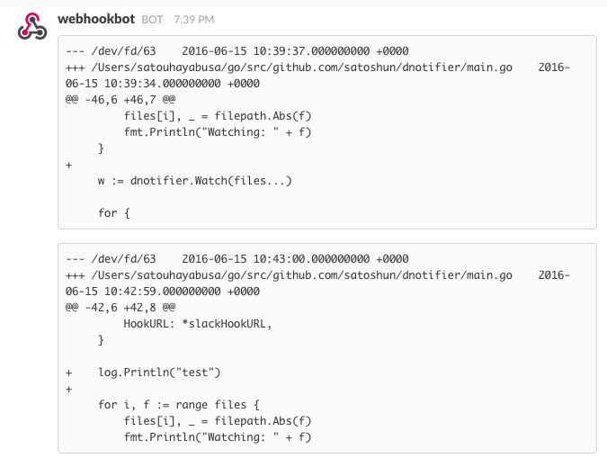
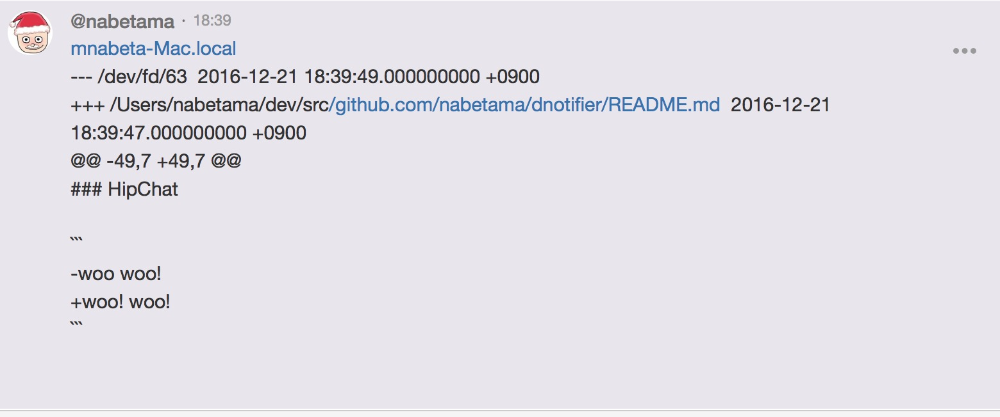

# dnotifier

Send slack and hipchat message when changed file.

It runs on OSX or Linux. If your platform is OSX, It must be install `fswatch`.

```shell
brew install fswatch
```


## install

```shell
go get github.com/satoshun/dnotifier
```


## usage

```shell
dnotifier slack -u ${your slack webhook url} -f ${file path} -f ${file path} ...
```


## example

### Slack

```shell
~/g/s/g/s/dnotifier ❯❯❯ dnotifier slack -u https://hooks.slack.com/services/xxxxxxxxx/xxxxxxxx/xxxxxxxxxxxx -f main.go
Watching: main.go
/Users/satouhayabusa/go/src/github.com/satoshun/dnotifier/main.go
2016/06/15 10:43:00 main.go:55: post:--- /dev/fd/63 2016-06-15 10:43:00.000000000 +0000
+++ /Users/satouhayabusa/go/src/github.com/satoshun/dnotifier/main.go 2016-06-15 10:42:59.000000000 +0000
@@ -42,6 +42,8 @@
    HookURL: *slackHookURL,
  }

+ log.Println("test")
+
  for i, f := range files {
    files[i], _ = filepath.Abs(f)
    fmt.Println("Watching: " + f)
```



### HipChat

```
~/dev/src/github.com/nabetama/dnotifier (git)-[hipchat]-
> ./dnotifier hipchat -hc-room <YOUR ROOM ID> -hc-token <YOUR ACCESS TOKEN> -f README.md -f /Users/nabetama/Desktop/blog.md
Watching: README.md ...
Watching: /Users/nabetama/Desktop/blog.md ...
2016/12/21 18:39:49 main.go:83: changed: /Users/nabetama/dev/src/github.com/nabetama/dnotifier/README.md
2016/12/21 18:39:49 hipchat_messenger.go:51: Send to hipchat.
```



## todos

- IRC, etc
